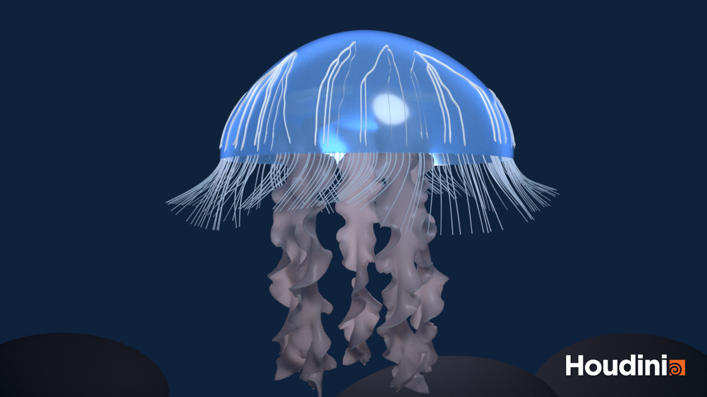
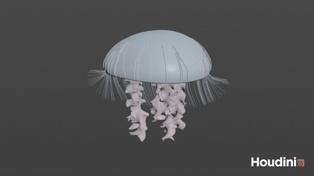
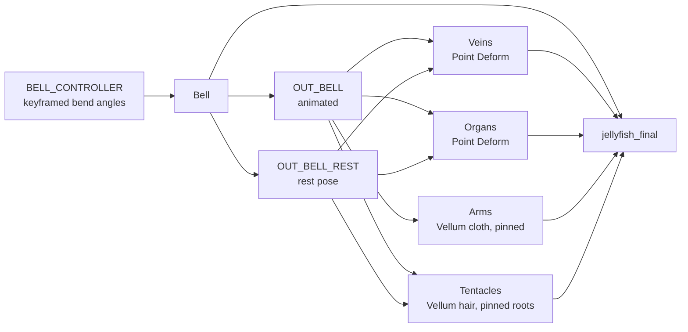
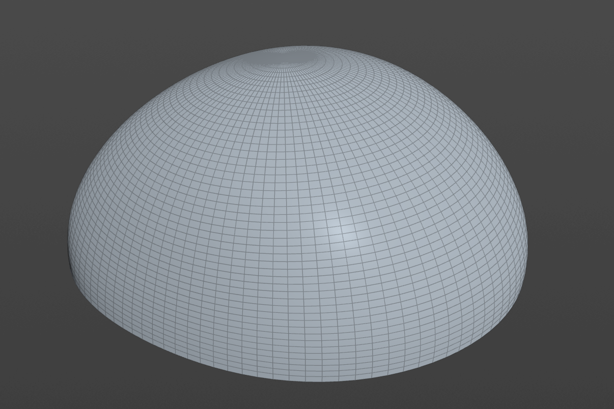
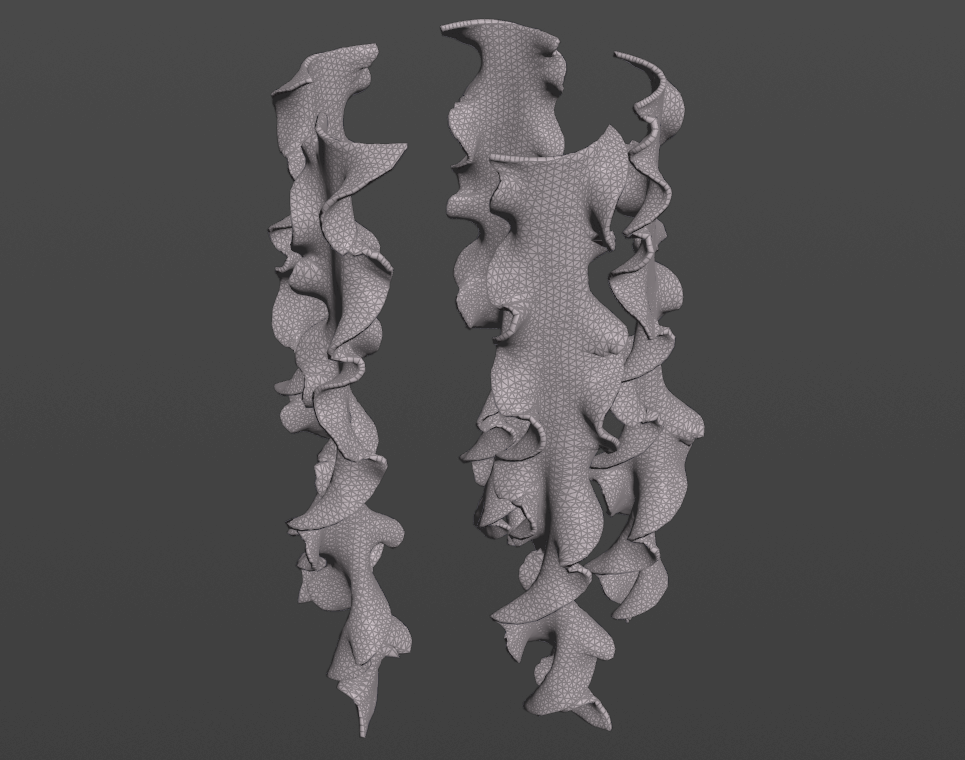
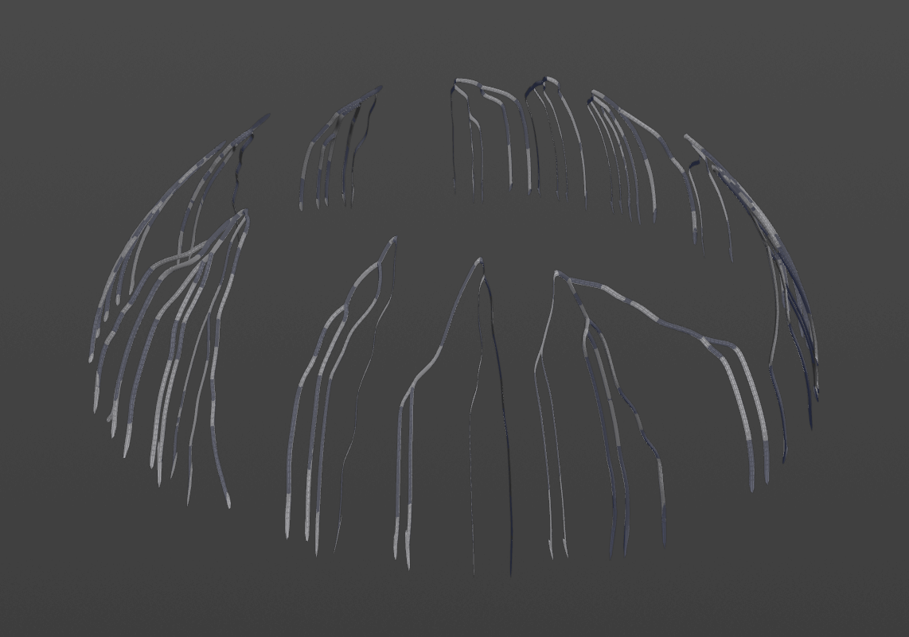
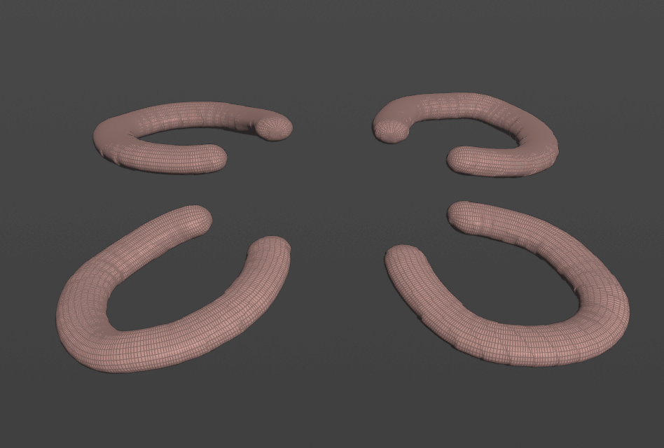
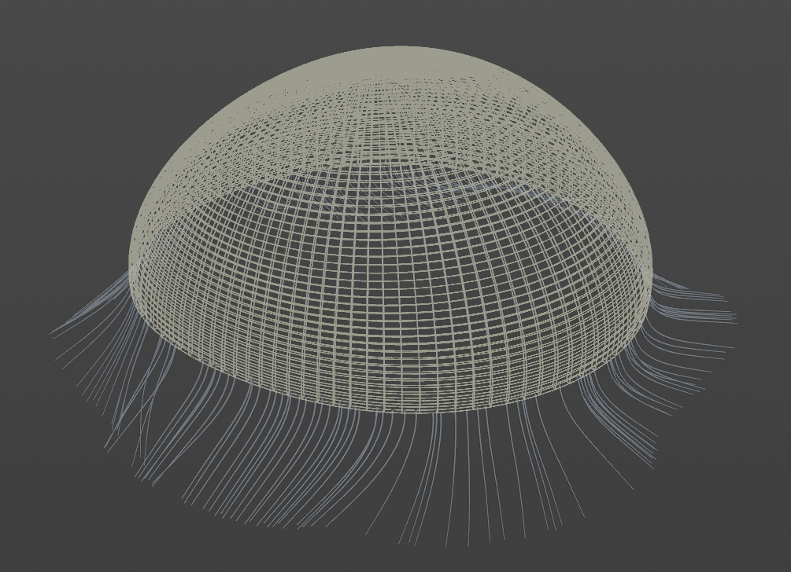
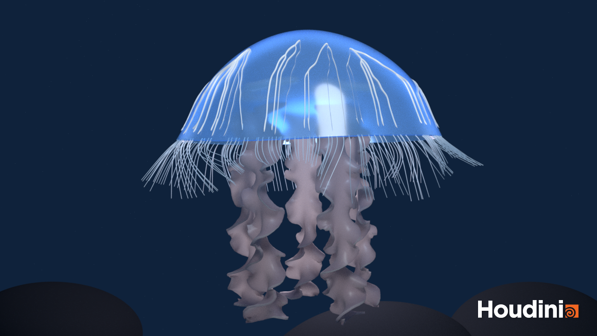

# Procedural Jellyfish

A procedural, animated jellyfish built in Houdini 22 (Apprentice). All generated with nodes and VEX. The animation is driven by keyframes on a single bell controller, and the other parts either follow the bell through Point Deform or are simulated with Vellum.

*Karma render, frame 66*

*Viewport animation ([mp4](assets/readme/jellyfish.mp4))*

## Overview

The bell is the only animated part. It outputs two versions of itself: the animated bell and a frozen rest pose with the same topology. Every other part is built on the rest pose and then follows the animated bell, either through Point Deform or by being pinned to it in a Vellum simulation.

## Bell

1. A single profile curve is bent into the bell shape with two Bend nodes, one for the main curve and one for the tip.
2. The bend angles are keyframed on a `BELL_CONTROLLER` null, so the whole pulse is controlled from one place.
3. The curve is revolved, given some surface noise and extruded for thickness.
4. A Time Shift branch freezes the bell on one frame to make `OUT_BELL_REST`, which the other parts use as their rest geometry.

## Arms

1. Grids are given ruffles, twisted and remeshed, then copied around the underside of the bell.
2. They are simulated as Vellum cloth, with the top row of points pinned to the animated bell (Pin to Target, Match Animation) so the arms swing with the pulse.
3. The simulation is cached and extruded for thickness.

## Veins

1. Only the outer surface of the rest bell is kept and remeshed into triangles, so the paths can run in any direction instead of following a square grid.
2. A wrangle picks a few start points near the top and many end points near the rim. It also writes a noisy `cost` attribute so the shortest paths meander instead of running straight down.
3. Find Shortest Path connects every end point to its nearest start, which naturally produces a branching network.
4. The paths are fused, resampled and smoothed, snapped back onto the surface with Ray and pushed slightly outward with Peak, then swept into tubes that taper toward the rim.
5. Point Deform makes the veins follow the animated bell.

## Organs

1. Each organ starts as an open arc that is noised, resampled and swept with round caps, giving a curled tube shape.
2. Four copies are arranged around the center, and a second large-scale noise makes each copy slightly different.
3. All the settings (size, thickness, spread, height, wobble, variation, seed) live on an `ORGAN_CONTROLLER` null, so the look can be tuned without opening the network.
4. Point Deform makes the organs follow the bell.

## Tentacles

There is no tentacle tutorial for this part, so it adapts a hair simulation tutorial instead. The useful parts were copying lines onto scattered points, setting them up as Vellum hair, pinning the roots, and adding POP Attract and POP Force in the solver to push the strands around. The second half of the video covers rendering in C4D, which did not apply.

1. Points are scattered on a band around the bell rim, and a short line is copied onto each one.
2. The roots are point-deformed to the animated bell. In the hair setup they are pinned with Match Animation, so the tentacles hang from the moving rim instead of from a static head.
3. Gravity, damping and drag are tuned for an underwater feel, so the tentacles trail behind the pulse.
4. The cached simulation is swept into thin tubes that taper toward the tips.

## Extra Credit: Karma Render

 

Two still frames (50 and 66) at different points in the pulse, rendered with Karma. The jellyfish is brought into Solaris with a SOP Import.

1. **Materials** - Each part has its own MaterialX Standard Surface in one material library:
   - **Bell**: mostly transmissive (0.9) with a blue tint, a light clear coat and a faint blue emission, so it reads as a glassy, glowing shell.
   - **Arms and organs**: use subsurface scattering in pink and coral for a soft, fleshy look.
   - **Veins**: near-white with a stronger emission (0.3), so they glow through the bell.
   - **Tentacles**: half transmissive with a slight emission, so they stay thin and delicate.
2. **Scene** - A large background sphere with a dark navy, slightly emissive material creates a deep-water backdrop. A few dark rocks sit at the bottom of the frame for scale.
3. **Lighting** - A dome light provides soft ambient fill, plus two additional lights for highlights.

## Notes
- The scene file is `jellyfish.hipnc`.
- Vellum caches are not included in the repository. Re-cache the arms and tentacles from their File Cache nodes after opening the scene.

## Credits
- Bell and arms are based on the course tutorials: [Jellyfish Bell Setup Video](https://www.youtube.com/watch?v=J3X8BB0yNRE) and [Jellyfish Arms Setup Video](https://www.youtube.com/watch?v=A_oNXqx8XH4).
- Tentacles adapt techniques from [this hair simulation tutorial](https://www.youtube.com/watch?v=LN4XXaHQkmU).
- Original instructions are in [instructions.md](instructions.md).
